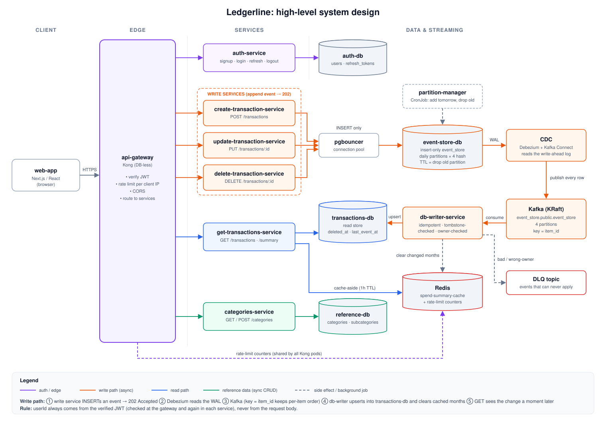

# Ledgerline: Distributed expense manager

[](https://github.com/joshichaitanya/ledgerline/actions/workflows/ci.yml)
[](LICENSE)

An event-driven expense tracker (record transactions, see monthly spend reports) built as microservices. Separate APIs write transaction events into an insert-only event store, CDC (Debezium) forwards every change to Kafka, and a consumer applies them into a read-optimized Postgres database, with a Redis cache in front of the reports.

It's a learning/showcase project: the design is meant to scale out, but it runs on one laptop and has **not** been load-tested. (Inside the code it still goes by its original working name, `scalable-demo`: package names, the k8s namespace, the JWT issuer.)

## What this project shows

- **Event store + CDC instead of dual writes**: APIs only insert into Postgres. Debezium reads the write-ahead log and publishes to Kafka, so the database and Kafka can never disagree ([ADR 0002](docs/adr/0002-event-store-before-kafka.md), [ADR 0007](docs/adr/0007-cdc-tool-vs-custom-service.md)).
- **Idempotent, order-safe consumer**: duplicates, replays and out-of-order events can't produce a wrong final result. Tombstones handle a delete that arrives before its create ([ADR 0009](docs/adr/0009-tombstones-as-deleted-at-column.md), [ADR 0010](docs/adr/0010-idempotency-via-last-event-at.md)).
- **Dead letter queue**: events that can never succeed go to a DLQ with headers saying why. Errors that may fix themselves (database down) keep retrying.
- **Partitioned event store with TTL**: daily Postgres partitions, hash-split by item id, dropped once old ([ADR 0003](docs/adr/0003-event-store-ttl-via-partition-drop.md), [ADR 0006](docs/adr/0006-event-store-hash-split-partitions.md)).
- **API gateway (Kong)**: JWT checks, per-IP rate limiting (shared through Redis) and CORS at the edge ([ADR 0008](docs/adr/0008-api-gateway-kong.md), [ADR 0016](docs/adr/0016-rate-limit-per-client-ip.md)).
- **Auth**: short-lived access tokens plus revocable refresh tokens. Every service takes `userId` from the verified token, never from the request ([ADR 0013](docs/adr/0013-user-id-from-verified-token.md)).
- **Cache-aside reports**: monthly spend totals cached in Redis and cleared by the consumer when data changes ([ADR 0011](docs/adr/0011-spend-summary-cache-aside.md)).
- **Testing**: service tests with Vitest against real Postgres/Redis (Testcontainers), and Playwright end-to-end tests that also run axe accessibility checks in light and dark themes.
- **Runs two ways**: `docker compose` locally, plus Kubernetes manifests (`k8s/`).
- **Decision records**: every non-obvious choice has an ADR in [`docs/adr/`](docs/adr/README.md).
- **System design docs**: requirements, database and API design, plus deep dives, in [`docs/system-design/`](docs/system-design/README.md).

**Tech stack:** TypeScript, Node.js/Express, Next.js/React, PostgreSQL, PgBouncer, Kafka (KRaft), Debezium/Kafka Connect, Redis, Kong, Docker Compose, Kubernetes, Vitest, Testcontainers, Playwright.

## Architecture



For requirements, database design, the API overview and deep dives, see [`docs/system-design/`](docs/system-design/README.md).

Key rules this design depends on:
- Kafka messages are keyed by the **item's own ID**, not `userId`. This keeps create/update/delete for the same item in order without making one busy user a hot partition ([ADR 0004](docs/adr/0004-kafka-key-item-id.md)).
- The **event store is insert-only**: a "delete" is a new row saying so, never a real `DELETE`. This lets CDC forward every change without confusing real deletes with routine cleanup ([ADR 0005](docs/adr/0005-event-store-insert-only.md)).
- Event-store rows **expire via TTL** (daily partitions, dropped once old) instead of row-by-row deletes, for the same reason.
- The consumer **checks for duplicates and tombstones** before applying an event, so out-of-order or repeated delivery can't cause a wrong final result in `transactions-db`.
- `create`/`update`/`delete-transaction-service` are three separate services rather than one with three routes. Each does exactly one write, so scaling, deploying or restarting one doesn't touch the others.
- Rate limiting and CORS live at the **gateway**. The access token is verified there *and* again in every service that acts for a user (`toolkit`'s `requireAuth`).
- A transaction's owner never changes: `db-writer-service` only applies an event from the user who owns the row, and sends anyone else's to the DLQ ([ADR 0014](docs/adr/0014-transaction-ownership-in-db-writer.md)).
- Users are the `auth-db` accounts created by signing up. That id is the one user id everywhere ([ADR 0012](docs/adr/0012-auth-db-user-id-everywhere.md)).

## Status

Everything in the diagram is built and tested end-to-end. Still open (see [`docs/TODO.md`](docs/TODO.md)):
- Kong doesn't yet see the real client IP behind the k8s ingress, so per-IP rate limiting only works fully in docker-compose.
- No tool yet to re-publish a fixed DLQ event.
- The k8s setup (automatic migrations and CDC registration) is written but not yet tested on a real cluster.
- E2E tests run in Chromium only.

`transaction-consumer-service` and `transaction-polling-consumer-service` are **legacy**: they come from the first, simpler design (publish straight to a `transactions` topic keyed by `userId`, consume straight into Postgres). Nothing publishes to that topic any more. They're kept for comparison and only start with `docker compose --profile legacy up`.

## Services

| Service | Role |
|---|---|
| `api-gateway` (Kong) | Single entry point for every backend service. `web-app` calls only this. Verifies the access token (JWT, matched to `auth-service`'s tokens via the `iss` claim), rate-limits per client IP, and handles CORS. DB-less mode: routing and plugins are one checked-in file, `infrastructure/api-gateway/kong.yml`. |
| `auth-service` | Express API. Sign-up, login, `/refresh`, logout, change-password. Issues short-lived access tokens and long-lived, revocable refresh tokens. Owns its own `auth-db` (credentials only). |
| `toolkit` (`@scalable-demo/toolkit`) | Shared package (local `file:` dependency, not published). `requireAuth`, the stateless access-token check used by every service that acts for a user. |
| `create-transaction-service` | Express API. `POST /transactions` writes a `create` row to `event_store`. Also owns the `event_store` schema and the partition-manager script. |
| `update-transaction-service` | Express API. `PUT /transactions/:id` writes an `update` row to `event_store`. |
| `delete-transaction-service` | Express API. `DELETE /transactions/:id` writes a `delete` (tombstone) row to `event_store`. |
| `get-transactions-service` | Express API. `GET /transactions` reads the logged-in user's rows from `transactions-db` (skipping deleted ones). `GET /transactions/summary?year=[&month=]` returns monthly spend totals per subcategory, cached in `spend-summary-cache` (ADR 0011). |
| `categories-service` | Express API on `reference-db`. `GET /categories` (shared defaults plus the user's own), `POST /categories`, `POST /categories/:id/subcategories` ([ADR 0015](docs/adr/0015-categories-shared-defaults-plus-custom.md)). |
| `db-writer-service` | The consumer. Reads `event_store.public.event_store` (from CDC) and applies each create/update/delete into `transactions-db`: idempotent via a `last_event_at` check, tombstone-checked via `deleted_at`, ownership-checked, with a DLQ for bad events. Clears affected cached months in `spend-summary-cache`. |
| `web-app` | Next.js frontend. Login/register/change-password, dashboard, transactions, reports. |
| `mock-data-generator` | Python scripts that generate demo users/categories/transactions. |
| `transaction-consumer-service` | **Legacy.** Push-style Kafka consumer (`eachBatch`) on the old `transactions` topic. Batches each Kafka batch into one idempotent multi-row INSERT. |
| `transaction-polling-consumer-service` | **Legacy.** Pull-style Kafka consumer on the same old topic, fetching only on a cron schedule (`node-cron`), pausing/resuming between ticks. |

| Infrastructure | Role |
|---|---|
| `event-store-db` | Postgres. Insert-only `event_store` table, keyed by item id, daily partitions dropped by a CronJob. Behind `pgbouncer`. |
| `pgbouncer` | Connection pooler in front of `event-store-db`, so many short-lived app connections share a small pool of real ones. |
| `kafka-connect` (CDC) | Debezium's Postgres connector in Kafka Connect. Watches `event-store-db`'s write-ahead log and publishes every `event_store` change to Kafka. Registered automatically on startup (see `infrastructure/cdc/README.md`). |
| `kafka` | Single-broker KRaft Kafka. Holds the CDC topic (4 partitions, keyed by item id), its DLQ, and the old `transactions` topic. Auto topic creation is off. |
| `transactions-db` | Postgres. The read-store, written only by `db-writer-service`. Readers must filter `deleted_at IS NULL`. |
| `reference-db` | Postgres. Categories/subcategories (shared defaults plus each user's own). |
| `auth-db` | Postgres. `auth-service`'s own database: `users` (credentials) and `refresh_tokens`. |
| `spend-summary-cache` | Redis. Cached monthly spend totals, plus the gateway's rate-limit counters. |

All services in `docker-compose.yml` have health checks and CPU/memory limits. See `infrastructure/*/README.md` for handy local commands (inspecting Kafka topics, `psql` queries, Redis) and each service's own folder for its code.

## API

Every endpoint, as called through `api-gateway` (`http://localhost:8000`), is described in [`docs/openapi.yaml`](docs/openapi.yaml) (OpenAPI 3). To browse it, paste the file into [editor.swagger.io](https://editor.swagger.io), or open it with an OpenAPI viewer in your editor.

## Running locally

**You need:** Docker (with about 6 GB of memory available to it, as the full stack is around 15 containers), Node.js 20 (see `.nvmrc`) and Yarn 1.

```
yarn install
docker compose up -d --build   # the whole backend; migrations and CDC registration run automatically
yarn frontend:up               # http://localhost:3100
```

(`yarn backend:up` starts only the API services and their databases. That's enough for sign-up/login and categories, but added transactions never reach `transactions-db` without Kafka, CDC and `db-writer-service`.)

Automated tests: `yarn test` runs every service's tests, `yarn e2e` runs the whole app in a browser (both need Docker running; see `docs/TESTING.md`).

See `docs/TESTING.md` for the full walkthrough (clean slate, health checks, testing the sign-up/login/transaction flow, querying each database, the equivalent Kubernetes steps).

## Security note

Every password and secret in this repo (`postgres/postgres`, `JWT_SECRET: local-dev-only-change-me`, `k8s/secret.yaml`, Postgres `trust` auth on `event-store-db`) is a **local-demo placeholder**. A real deployment would use generated secrets from a secret manager and proper database auth.

## Next steps

See [`docs/TODO.md`](docs/TODO.md).

## License

[MIT](LICENSE)
