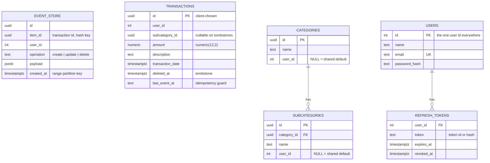

# Database design (high level)

Each database is owned by exactly one service, which also owns its migrations. No service reads another service's database.

| Store | Type | Owner (writes) | Readers | Purpose |
|---|---|---|---|---|
| `event-store-db` | Postgres (behind `pgbouncer`) | create / update / delete-transaction-service | Debezium (via WAL only) | Short-lived log of every transaction change |
| `transactions-db` | Postgres | `db-writer-service` | `get-transactions-service` | Current state of every transaction (read store) |
| `reference-db` | Postgres | `categories-service` | `categories-service` | Categories and subcategories |
| `auth-db` | Postgres | `auth-service` | `auth-service` | Credentials and refresh tokens |
| `spend-summary-cache` | Redis | `get-transactions-service` (fill), `db-writer-service` (clear), Kong (counters) | same | Cached monthly totals + rate-limit counters |
| Kafka | Topics | Debezium, `db-writer-service` (DLQ) | `db-writer-service` | Event stream between the stores |

This page shows the key columns only. Exact types and constraints live in each service's `migrations/` folder.



The lines between databases (e.g. `transactions.user_id` → `users.id`, `transactions.subcategory_id` → `subcategories.id`) are **logical only**. Postgres can't enforce a foreign key across databases.

## event-store-db

Migration: `services/create-transaction-service/migrations/1700000000001_event_store.js`

- **Insert-only.** A delete is a new row with `operation = 'delete'`, never a SQL `DELETE` ([ADR 0005](../adr/0005-event-store-insert-only.md)).
- **Partitioned twice:** by day on `created_at` (range), then each day into 4 buckets by `HASH(item_id)`.

  ```
  event_store
  ├── event_store_2026_10_29          (RANGE: one day)
  │   ├── event_store_2026_10_29_0    (HASH item_id, remainder 0)
  │   ├── event_store_2026_10_29_1
  │   ├── event_store_2026_10_29_2
  │   └── event_store_2026_10_29_3
  ├── event_store_2026_10_30 ...
  └── event_store_default             (safety net)
  ```
- **Primary key** `(id, created_at, item_id)`: Postgres needs every partition key in the primary key.
- **No secondary indexes.** Nothing queries this table; Debezium reads the WAL. Indexes would only slow inserts.
- **TTL:** a daily CronJob creates tomorrow's partition and drops partitions older than 1 day. See [deep dive 3](deep-dives/03-event-store-partitioning-ttl.md).
- `wal_level=logical` and a publication with `publish_via_partition_root = true`, so CDC sees rows as `event_store`, not as the partition name.

## transactions-db

Migrations: `services/db-writer-service/migrations/transactions/`

- One row per transaction, keyed by the **client-chosen** UUID ([ADR 0001](../adr/0001-client-generated-transaction-id.md)).
- `amount` is `numeric(12,2)`: exact decimals for money, no float rounding.
- `deleted_at`: set by a delete and never cleared. **Every reader must filter `WHERE deleted_at IS NULL`** ([ADR 0009](../adr/0009-tombstones-as-deleted-at-column.md)).
- A tombstone row may hold only `id`, `user_id`, `deleted_at` (delete arrived before create). A `CHECK` keeps the other fields required on live rows.
- `last_event_at`: the `event_store.created_at` of the last applied event, kept at microsecond precision. An event is applied only if it is newer ([ADR 0010](../adr/0010-idempotency-via-last-event-at.md)).
- Main reads: "my transactions, newest first" and "sum by subcategory for a month", both filtered by `user_id`.

## reference-db

Migrations: `services/categories-service/migrations/`

- `user_id IS NULL` → shared default (12 categories, added by a migration so ids match in every environment).
- `user_id = <id>` → a user's own category/subcategory, only visible to them ([ADR 0015](../adr/0015-categories-shared-defaults-plus-custom.md)).
- Names are unique per user, ignoring case, across defaults + own.

## auth-db

Migrations: `services/auth-service/migrations/`

- `users.id` is the single user id used in every other store ([ADR 0012](../adr/0012-auth-db-user-id-everywhere.md)).
- `refresh_tokens` lets a session be revoked: logout revokes one, change-password revokes all of a user's tokens. Refresh rotates the token on every use.

## Redis (`spend-summary-cache`)

| Key | Value | Written by | Cleared by | TTL |
|---|---|---|---|---|
| `user:{userId}:month:{YYYY-MM}` | JSON `{ subcategoryId: total }` | `get-transactions-service` on a cache miss | `db-writer-service` when a row in that month changes | 1 hour |
| Kong rate-limit counters | request count per IP per window | Kong | expire by themselves | the rate-limit window |

## Kafka topics

| Topic | Key | Partitions | Producer | Consumer |
|---|---|---|---|---|
| `event_store.public.event_store` | `item_id` | 4 | Debezium | `db-writer-service` |
| DLQ topic | `item_id` | — | `db-writer-service` | people (manual check) |
| `transactions` (legacy) | `userId` | — | nothing now | legacy consumers (`--profile legacy`) |

Auto topic creation is off. Retention is Kafka's default 7 days.
