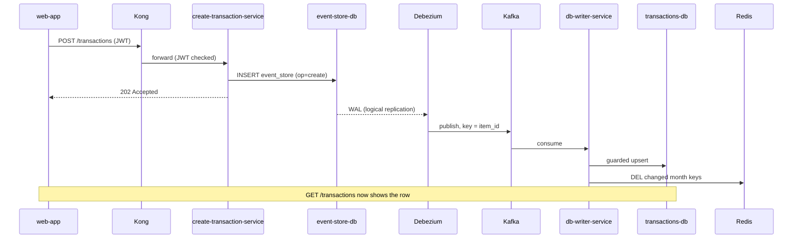

# Deep dive 1: Write path: event store + CDC instead of dual writes

## The problem

A write service needs to do two things: save the change, and tell the rest of the system about it (Kafka). Doing both from the API is a **dual write**:

```ts
await db.insert(tx);          // 1. succeeds
await kafka.send(txEvent);    // 2. crashes here → DB has it, Kafka never hears about it
```

Whatever order you pick, a crash between the two steps leaves them disagreeing.

## The solution

The API does **one** write: an `INSERT` into `event_store`. Postgres already records every committed row in its write-ahead log (WAL). Debezium reads the WAL and publishes each row to Kafka. So "saved" and "published" come from the same commit and can't disagree ([ADR 0002](../../adr/0002-event-store-before-kafka.md), [ADR 0007](../../adr/0007-cdc-tool-vs-custom-service.md)).



## Key details

- **Insert-only.** The event store never gets an `UPDATE` or `DELETE` from the app. A delete is a new row with `operation = 'delete'`. Then every WAL entry Debezium sees is a real event, and dropping an old partition (cleanup) is never confused with a user's delete ([ADR 0005](../../adr/0005-event-store-insert-only.md)).
- **Key = `item_id`.** Set with Debezium's `message.key.columns`. Without it, the key would be the full primary key `(id, created_at, item_id)`, which is different for every event and would break per-item ordering.
- **`publish_via_partition_root = true`.** Without it, rows arrive tagged with the partition name (`event_store_2026_10_29_2`), don't match `table.include.list`, and are **silently dropped**. It must be set on the Postgres publication (`infrastructure/cdc/prepare-publication.sql`); the similar-looking Debezium property does nothing. Found in testing.
- **Debezium connects directly**, not through `pgbouncer`. Logical replication needs one long-lived connection; pgbouncer's transaction pooling can't give that.
- **Registration is automatic** and safe to re-run (`PUT /connectors/.../config`).

## Trade-offs

| Gain | Cost |
|---|---|
| No dual write, no lost events | Writes are eventually consistent: the API answers before the read store has the change |
| API stays tiny: one `INSERT` | More moving parts: Kafka Connect, Debezium, a publication, a replication slot |
| Kafka can be down and writes still work | A replication slot holds WAL on disk until Debezium reads it. If CDC is down for long, the event-store disk fills up |
| Event store is a short replay buffer | Kafka keeps 7 days; anything older can only be rebuilt from `transactions-db` itself |

## What it would take to scale

- More write-service replicas: free (stateless).
- More Kafka partitions: raises consumer parallelism. Per-item order still holds because the key is the item id. Changing the count moves keys between partitions, so do it when the consumer is caught up.
- One Debezium task per Postgres database is the limit. If WAL volume outgrows it, shard the event store (e.g. by item id) and run one connector per shard.
