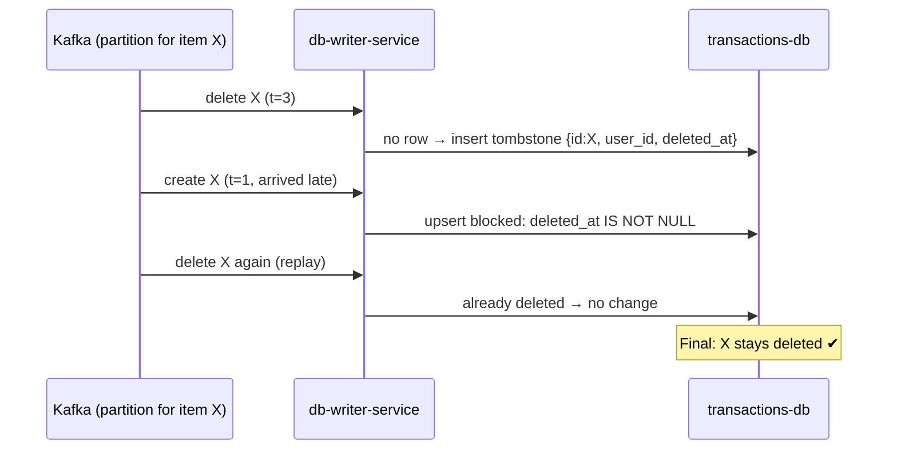

# Deep dive 2: Ordering, idempotency, tombstones and ownership in `db-writer-service`

Kafka gives **at-least-once** delivery. So `db-writer-service` will sometimes see an event twice, see an old event after a newer one (after a replay), or see a delete before its create. None of these may give a wrong final row.

## Four problems, one SQL statement

| Problem | Example | Guard |
|---|---|---|
| Duplicate / replay | Consumer crashes after writing but before committing its offset | `last_event_at` must be **newer** ([ADR 0010](../../adr/0010-idempotency-via-last-event-at.md)) |
| Out of order | Update arrives before create | Create and update are both a full **upsert**, so either order gives the same row |
| Delete first | Delete arrives, then a late create | Delete inserts a **tombstone** (`deleted_at`) that blocks later writes ([ADR 0009](../../adr/0009-tombstones-as-deleted-at-column.md)) |
| Wrong owner | User B sends an update for user A's id | Apply only if the row's `user_id` matches; otherwise **DLQ** ([ADR 0014](../../adr/0014-transaction-ownership-in-db-writer.md)) |

All four checks sit in the same `INSERT ... ON CONFLICT` statement, so there is nothing to race. A simplified shape of the create/update apply:

```sql
INSERT INTO transactions (id, user_id, subcategory_id, amount, description,
                          transaction_date, last_event_at)
VALUES ($1, $2, $3, $4, $5, $6, $7)
ON CONFLICT (id) DO UPDATE SET
  subcategory_id   = EXCLUDED.subcategory_id,
  amount           = EXCLUDED.amount,
  description      = EXCLUDED.description,
  transaction_date = EXCLUDED.transaction_date,
  last_event_at    = EXCLUDED.last_event_at
WHERE transactions.last_event_at < EXCLUDED.last_event_at   -- newer only
  AND transactions.deleted_at IS NULL                       -- not tombstoned
  AND transactions.user_id = EXCLUDED.user_id;              -- same owner
```

(See `services/db-writer-service` for the real statements.)

If it changed **zero rows**, one extra lookup tells "duplicate / stale / tombstoned" (skip quietly) apart from "wrong owner" (send to DLQ).

## Walk-through: delete arrives before create



## Why ordering mostly "just works"

The Kafka key is `item_id` ([ADR 0004](../../adr/0004-kafka-key-item-id.md)), so all events for one transaction land in one partition and arrive in order. The guards above are the safety net for replays and edge cases, not the main mechanism.

Keying by `userId` would also keep order, but one very active user would make one hot partition. Item id spreads load evenly.

## Timestamps: a small but real detail

`last_event_at` is kept as Debezium's ISO string with **microseconds**. JavaScript `Date` only keeps milliseconds, so two events in the same millisecond would look equal and the second would be wrongly skipped.

Known edge case: Postgres `now()` is the transaction **start** time. Two writes to the same item racing within microseconds could commit in the opposite order of their timestamps. Accepted as very rare.

## Errors: retry or DLQ?

| Kind | Example | Action |
|---|---|---|
| May fix itself | `transactions-db` down, network blip | Retry; don't commit the offset |
| Never fixable | Bad payload, missing fields, wrong owner | Send to DLQ with a reason header, commit offset, move on |
| Cache failure | Redis down | Log it, remember the key, delete it on reconnect. Never stall the pipeline over a cache |

## Trade-offs

- No `processed_events` table to grow forever, and stale events are blocked too (a seen/not-seen table can't tell older from newer).
- Tombstones are never cleaned up, so `transactions` only grows. A real system would remove tombstones older than the longest possible event delay.
- The API answers `202` to a wrong-owner request; the user only "finds out" through the DLQ. Fine, because a real user of the web app never sends one.
