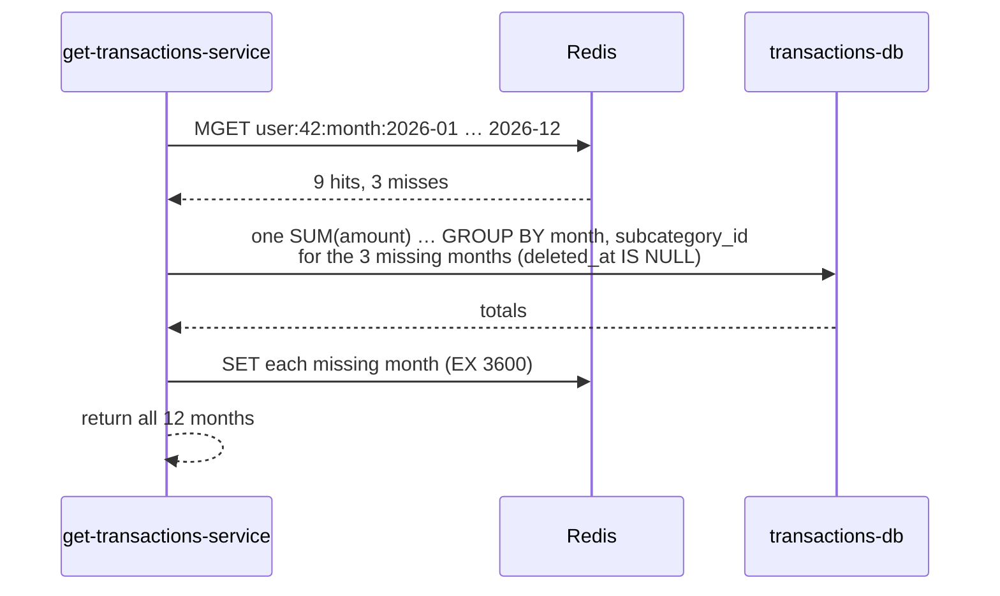

# Deep dive 4: Spend summary cache (cache-aside)

The reports page needs "how much did I spend per subcategory each month". Adding up every transaction on every page load is wasteful, so monthly totals are cached in Redis ([ADR 0011](../../adr/0011-spend-summary-cache-aside.md)).

## Key and value

```
key:   user:42:month:2026-10
value: {"3f2c8a6e-...":120.75, "9b1d...":60}
TTL:   1 hour
```

Months are **UTC** calendar months.

## Read: `GET /transactions/summary?year=2026`



One `MGET` for all months, one SQL query for all misses. Never one query per month.

## Write: when `db-writer-service` changes a row

It deletes the key for the month the row **was** in and the month it **is now** in. An edit can move a transaction from October to September, and both totals change.

```ts
// simplified
const keys = new Set([
  monthKey(oldRow.userId, oldRow.transactionDate),
  monthKey(newRow.userId, newRow.transactionDate),
]);
await redis.del([...keys]);
```

## Why invalidate, not update the total in place

Option B was "add/subtract each event's amount to the cached total". Rejected because:

- **A replayed event would be counted twice.** Deleting a key twice is harmless; adding an amount twice is not. Invalidation keeps the idempotency that [ADR 0010](../../adr/0010-idempotency-via-last-event-at.md) gives the database.
- The cache is **never the source of truth**. It can be flushed at any time and refills on the next read.

## Failure cases and how they're covered

| Case | What happens |
|---|---|
| Redis down during a read | Reader computes from `transactions-db` and returns. Slower, still correct. |
| Redis down during a write | `db-writer-service` logs it, remembers the key (in memory, up to 10,000 keys), deletes it when Redis is back. Pipeline never stalls. |
| Consumer restarts while Redis is down | The remembered keys are lost → total may be stale until the **1h TTL** |
| Crash between DB write and cache delete | Redelivered event changes nothing, so deletes nothing → stale until TTL |
| Classic race: reader computes, change + delete happen, reader stores old value | Stale until TTL |

The 1 hour TTL is the safety net that caps how long any wrong total can live.

## Trade-offs

- Simple and replay-safe, at the cost of a possible stale total for up to 1 hour in rare cases.
- Only monthly totals are cached. Daily totals can be added the same way later; they'd fill themselves on first read.
- UTC month boundaries: a transaction near midnight at month end may show in the neighbouring month for users far from UTC.
