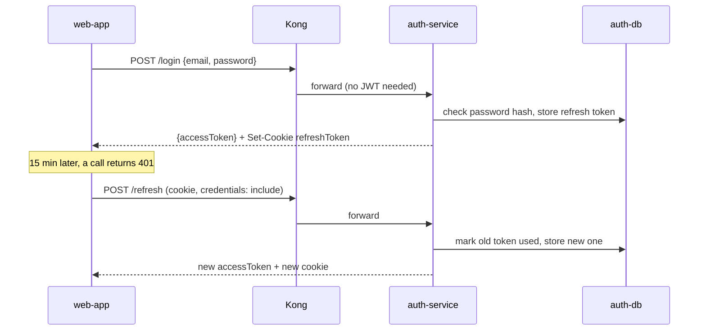

# Deep dive 5: Auth, tokens and the gateway

## Two tokens

| | Access token | Refresh token |
|---|---|---|
| Form | JWT (`userId`, `jti`, `iss = scalable-demo`, `iat`, `exp`) | Token recorded in `auth-db` (`refresh_tokens`) |
| Lifetime | 15 minutes | 30 days |
| Sent as | `Authorization: Bearer ...` header | `refreshToken` httpOnly cookie only |
| Checked by | Kong + every service, **without** a DB call | `auth-service`, against `auth-db` |
| Can be revoked | No (just expires) | Yes: logout, change-password, rotation |

Short-lived stateless tokens keep every request fast. The revocable refresh token gives back the control a stateless token lacks: after logout, a stolen access token works for at most 15 more minutes.

## Login and refresh flow



**Rotation:** each refresh token works once. If an old one is used again, it's refused and the cookie is cleared.

## Defence in depth: the token is checked twice

1. **Kong** verifies the JWT signature and expiry (matched by the `iss` claim) and rejects bad calls before they reach any service.
2. **Each service** checks it again with `toolkit`'s `requireAuth`. If someone reaches a service directly inside the cluster, it still can't be called without a valid token.

And the service always takes the user from the token ([ADR 0013](../../adr/0013-user-id-from-verified-token.md)):

```ts
// inside a service route, after requireAuth
const userId = req.user.userId;   // from the verified token
// req.body.userId is ignored
```

The token says **who** you are. It doesn't say you **own** transaction X; that is checked later in `db-writer-service` ([deep dive 2](02-consumer-correctness.md)).

## Gateway (Kong)

Runs DB-less: routes and plugins are one checked-in file, `infrastructure/api-gateway/kong.yml` ([ADR 0008](../../adr/0008-api-gateway-kong.md)).

| Job | Detail |
|---|---|
| Routing | One public host; each path goes to its service. The web app knows only the gateway URL. |
| JWT check | All routes except `/signup`, `/login`, `/refresh`. |
| Rate limit | Per client IP, 1000/min (compose), 100/min (k8s). Counters in Redis so all Kong pods share one count ([ADR 0016](../../adr/0016-rate-limit-per-client-ip.md)). |
| CORS | Handled once here, not in every service. |

**Why per IP, not per user?** It also protects `/login` and `/signup`, where there's no user yet (e.g. password guessing).

**Known gap:** in k8s, Kong sits behind the ingress and sees the ingress's IP, not the real client's. So all clients share one counter there until Kong is told to trust the forwarded IP header.

## One user id everywhere

`users.id` in `auth-db` is the only user id. Transactions, events, categories and cache keys all use it ([ADR 0012](../../adr/0012-auth-db-user-id-everywhere.md)). No mapping table, no second id.
